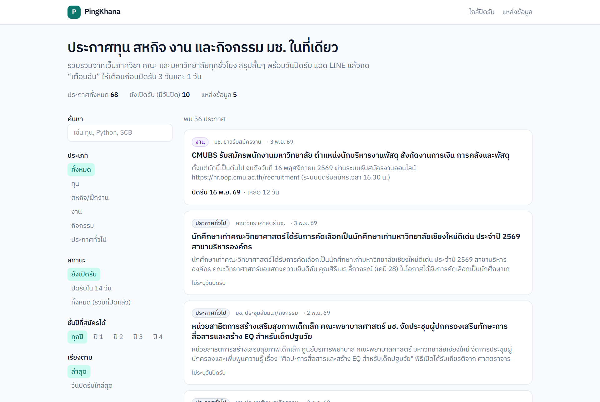
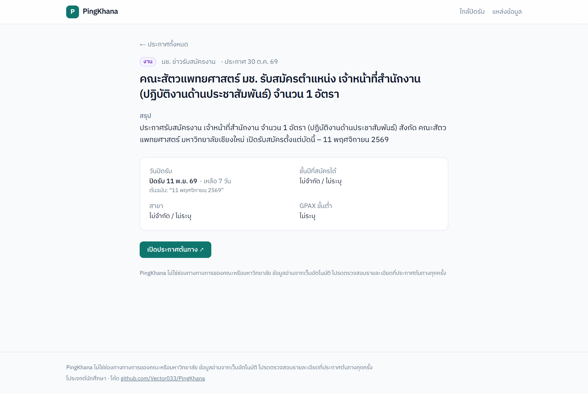
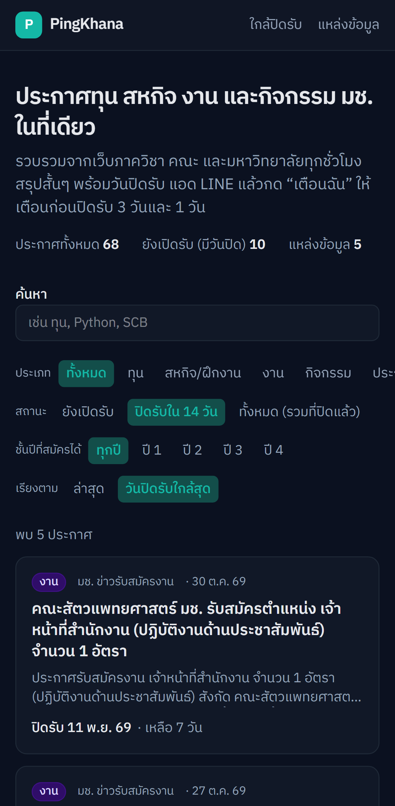

# PingKhana

**LINE bot + website that collects scholarship, co-op, job and event announcements from Chiang Mai University web pages, reads the application deadline, and reminds students before it closes.**

> PingKhana รวมประกาศทุน สหกิจ งาน และกิจกรรมจากเว็บภาควิชา คณะ และมหาวิทยาลัยเชียงใหม่ อ่านวันปิดรับให้อัตโนมัติ และให้ LINE เตือนก่อนปิดรับ 3 วันและ 1 วัน
> ไม่ใช่ช่องทางทางการของคณะหรือมหาวิทยาลัย



| Announcement detail | Phone, closing soon (dark) |
|---|---|
|  |  |

## Why

Announcements are spread over many department, faculty and university pages. Nobody checks all of them every day, so deadlines get missed (the author missed SCB Co-op 2027, which closed on 20 Oct 2026, this way).

## What it does

- **Collector**: reads 5 public CMU pages every hour (see [docs/sources.md](docs/sources.md)). It handles HTML (with RSS support for later sources), obeys robots.txt, identifies itself in the User-Agent, waits between requests and retries on 5xx/429. Duplicates are caught by URL and by a hash of the content, so a post cross-posted on two sites counts once. When a page changes, for example a title gaining "ขยายเวลา" (extended), it is re-read and re-extracted. If a list page stops matching its selectors (a redesign), the source is flagged on `/sources`.
- **Extraction**: a Thai summary, a category (scholarship, co-op/internship, job, activity, general), the **deadline**, eligible years, majors and minimum GPAX. Gemini runs with a JSON response schema when `GEMINI_API_KEY` is set. Otherwise a rule-based extractor is used; it also serves as the fallback and the baseline.
- **LINE bot**: chat commands `ทุนที่เปิดอยู่` (open scholarships), `สหกิจล่าสุด` (latest co-op), `ใกล้ปิดรับ` (closing soon), `เตือนของฉัน` (my reminders), `ตั้งค่า` (settings), `ยกเลิก` (delete my data). Answers come back as flex carousels with a "เตือนฉัน" (remind me) button, the source link and a disclaimer.
- **Reminders**: 3 days and 1 day before the deadline, for announcements the user pressed "เตือนฉัน" on.
- **LIFF settings page**: users pick categories, year and major. Only matching announcements are sent.
- **Public website** (Next.js): search, filters for category, status, year and sort, detail pages, and source health.

## Staying inside the free LINE quota

The free LINE Official Account plan in Thailand allows **300 push messages a month**, counted per recipient ([lineforbusiness.com](https://www.lineforbusiness.com/th/service/line-oa-features/broadcast-message), checked 2026-11-04). Reply messages are free. The design follows from that:

- No broadcasts. Each user gets only announcements that match their categories, year and major.
- Everything queued for one user goes into **one push request** (up to 5 message objects), so it costs one message no matter how many items it carries. New announcements are batched into at most one digest per user per day.
- **Reminders come first.** Half the monthly budget, or more if more reminders are already scheduled for the rest of the month, is reserved for deadline reminders. Digests are pushed only above that reserve.
- **Nothing is lost when the budget runs out.** Queued items stay in an outbox and ride along on the user's next reply, which is free, and expire after 14 days.
- Idempotency: each delivery has a unique `dedupe_key`, and pushes carry `X-Line-Retry-Key`, so a job that runs twice or retries never sends twice. Webhook redeliveries are ignored by `webhookEventId`.
- The real usage is read from LINE's `quota` and `quota/consumption` endpoints when available.

## Deadline extraction accuracy

Run with `python -m eval.run_deadline_eval [--set holdout]`. A case is correct when the date matches exactly, or both sides are "no deadline".

| Set | Cases | Rule-based extractor |
|---|---|---|
| Dev set: 26 real sentences + 10 whole saved pages + 12 synthetic ([eval/deadline_cases.yaml](backend/eval/deadline_cases.yaml)) | 48 | 93.8% before tuning → 100% after (the rules were tuned on this set) |
| **Held-out set**: 34 real passages from CMU, KKU and TU pages, collected by a separate agent that never saw the extractor code ([eval/deadline_holdout.yaml](backend/eval/deadline_holdout.yaml)) | 34 | **94.1% on the first (blind) run** (32/34). Both misses were fixed afterwards, so later runs on this set are no longer blind |

Gemini has not been measured yet because there is no API key on the dev machine. `--gemini` runs the same sets.
About 45% of the cases have **no** deadline (event days, interview dates, posting dates). Telling those apart is the hard part, not parsing `๒๙ ต.ค. ๖๙`.

## Numbers from real use

| | |
|---|---|
| Announcements collected (first run, 2026-11-04) | 68 from 5 sources |
| LINE followers | not launched yet |
| Reminders sent | 0 (not launched yet) |

## Architecture

```
GitHub Actions cron (hourly) ──POST /jobs/run──▶ FastAPI (backend/)
                                                  ├─ collector: fetch → parse → dedupe → store
                                                  ├─ extract: Gemini (JSON schema) or rules
                                                  └─ notify: plan reminders/digests → push within budget
LINE platform ──webhook──▶ /webhook (signature checked) ──reply──▶ user
LIFF page (web/liff) ──ID token──▶ /api/liff/* (token verified with LINE)
Next.js site (web/) ──▶ /api/announcements, /api/stats
Postgres (announcements, users, reminders, deliveries outbox, fetch_runs)
```

- **backend/**: Python 3.12, FastAPI, SQLAlchemy 2 (async) + Alembic, httpx, selectolax. Tests use pytest against real Postgres, respx for HTTP, and fixtures saved from each source.
- **web/**: Next.js 16 (App Router, Cache Components), TypeScript, Tailwind 4, LIFF SDK, Playwright.

## Privacy

- Stored per user: LINE userId, year, major, chosen categories and reminders. Nothing else.
- Typing `ยกเลิก`, pressing "delete my data" in LIFF, or blocking the bot deletes all of it.
- For result lists ("ประกาศรายชื่อผู้ได้รับทุน", lists of scholarship recipients), only the title and link are stored, never the names.

## Run locally

Requirements: Docker, Python 3.12, Node 24 or newer.

```bash
docker compose up -d                       # Postgres on :54532 (+ test DB)
cd backend
python -m venv .venv && .venv/Scripts/pip install -e ".[dev]"   # bin/ on macOS/Linux
cp .env.example .env
.venv/Scripts/alembic upgrade head
.venv/Scripts/python -m app.jobs all       # collect from the real sites (polite, ~5 min first time)
.venv/Scripts/uvicorn app.main:app --port 8100
```

```bash
cd web
cp .env.example .env.local
npm install && npm run dev                 # http://localhost:3000, settings page at /liff
```

Without LINE credentials the bot runs **dry**: messages are logged instead of sent, and `/liff` works with a fake local user.
Tests: `pytest` in `backend/` and `npx playwright test` in `web/` (that one needs the API running with `python -m scripts.seed_demo`).

Connecting to a real LINE channel and deploying: [docs/line-setup.md](docs/line-setup.md).
