# PingKhana

**LINE bot + website that collects scholarship, co-op, job and event announcements from Chiang Mai University web pages, reads the application deadline, and reminds students before it closes.**

> PingKhana รวมประกาศทุน สหกิจ งาน และกิจกรรมจากเว็บภาควิชา คณะ และมหาวิทยาลัยเชียงใหม่ อ่านวันปิดรับให้อัตโนมัติ และให้ LINE เตือนก่อนปิดรับ 3 วันและ 1 วัน
> ไม่ใช่ช่องทางทางการของคณะหรือมหาวิทยาลัย

**Live:** https://pingkhana.vercel.app · LINE bot `@524osura` (screenshots from the deployed site and the real bot, 2026-11-08)

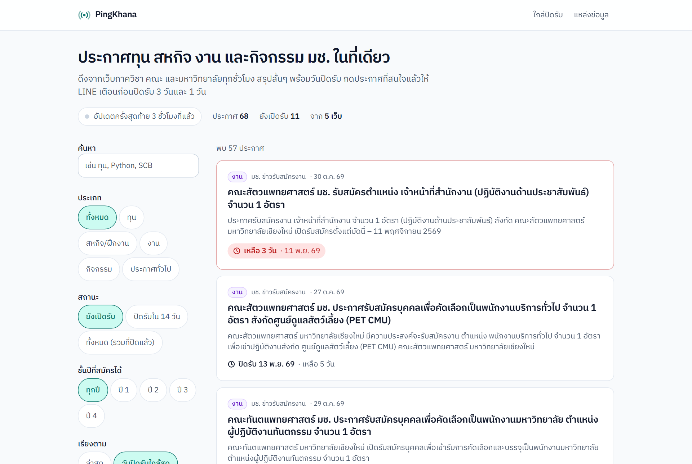

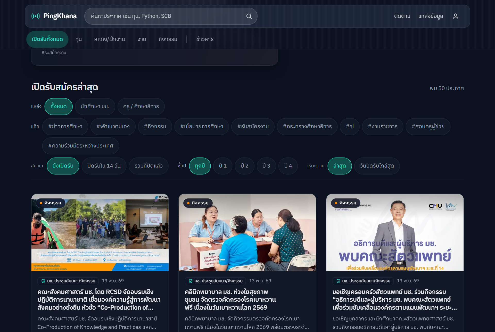

| News zone, teacher pack (สพฐ. and teacher-news sites) | Add a source by pasting a link |
|---|---|
| 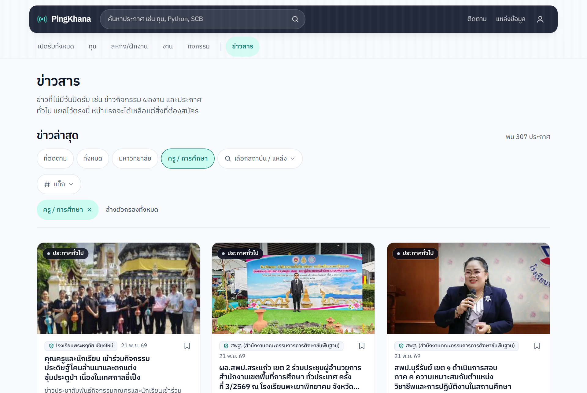 | 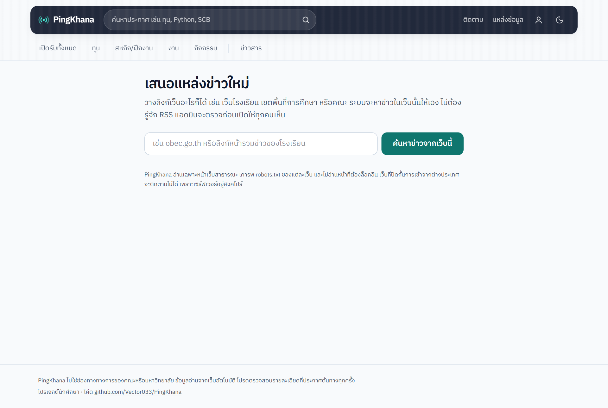 |

| Quick preview drawer (dark) | Phone: bottom sheet with the LINE reminder button |
|---|---|
| 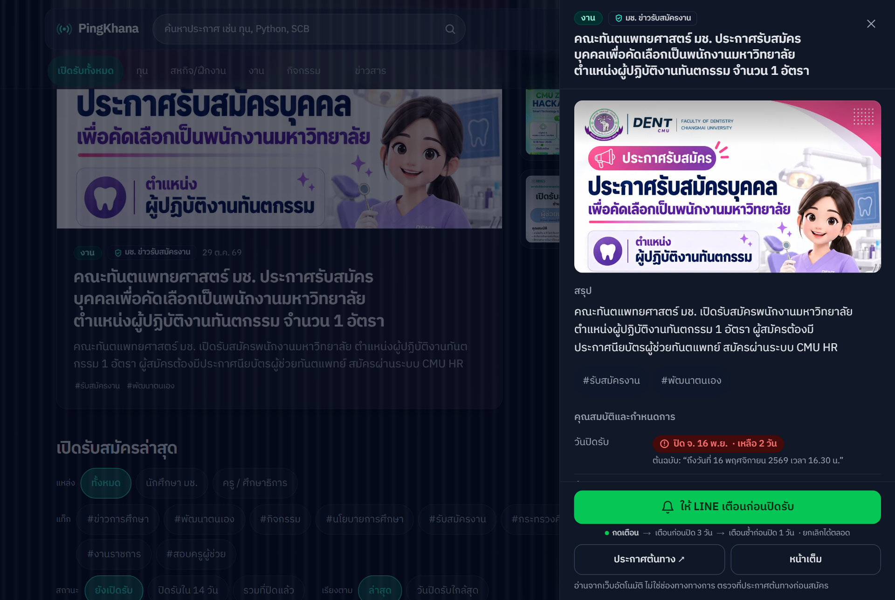 | 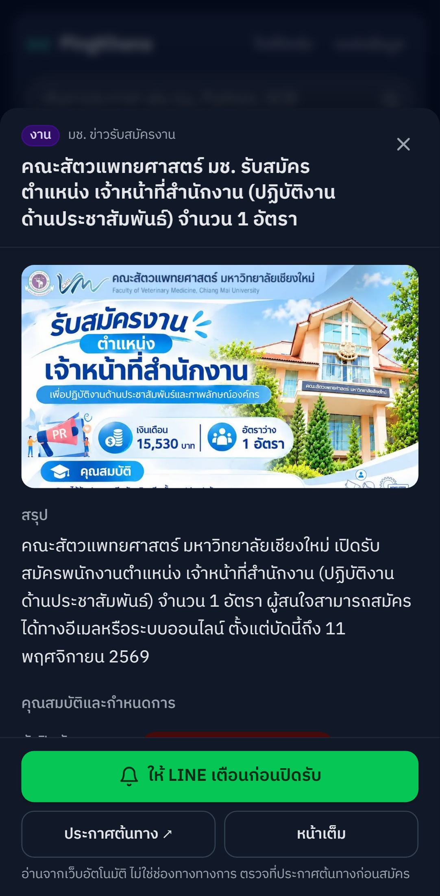 |

| LINE: "ใกล้ปิดรับ" answered with a carousel | LINE: set a reminder, open settings, delete my data |
|---|---|
| 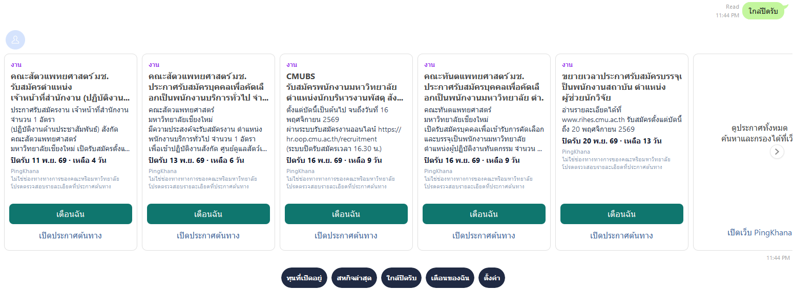 | 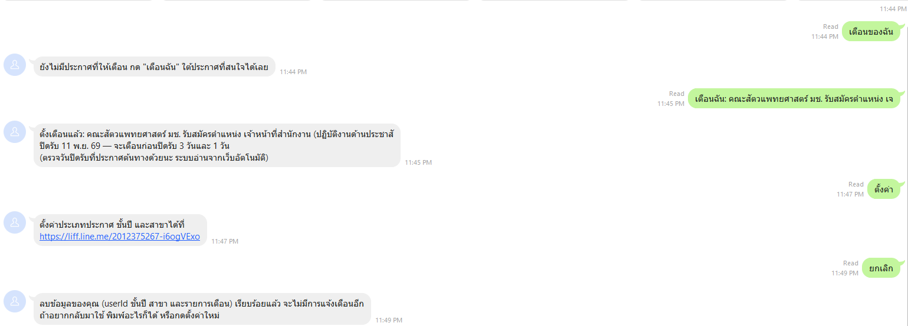 |

## LINE bot walkthrough

Real chat with the deployed bot (`@524osura`), in order. Script: [docs/line-demo.md](docs/line-demo.md).

| | |
|---|---|
| **1. Add the bot**: welcome, settings link, commands, quick replies<br>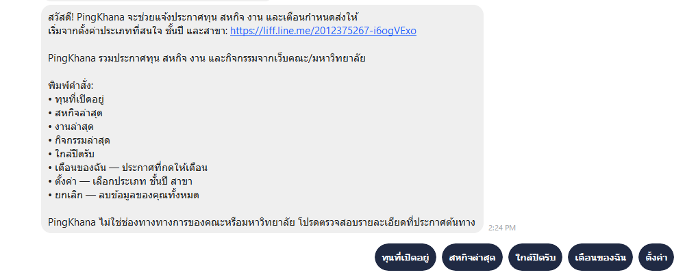 | **2. `ทุนที่เปิดอยู่`**: open scholarships as a carousel, each with the source link<br>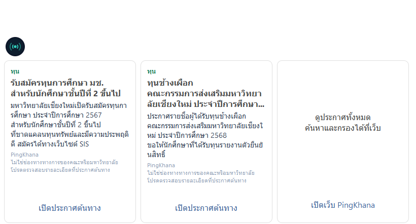 |
| **3. `ใกล้ปิดรับ`**: closing within 14 days, soonest first, red when 3 days or less<br>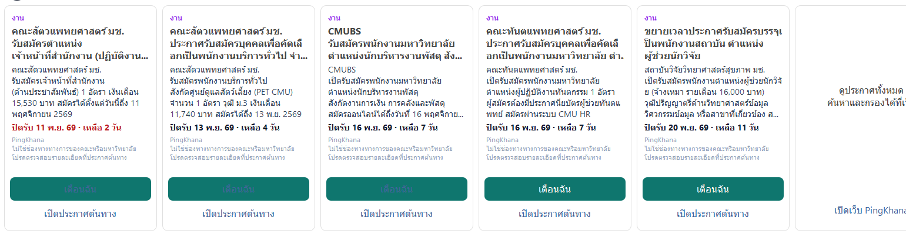 | **4. Press เตือนฉัน**: reminders 3 days and 1 day before<br>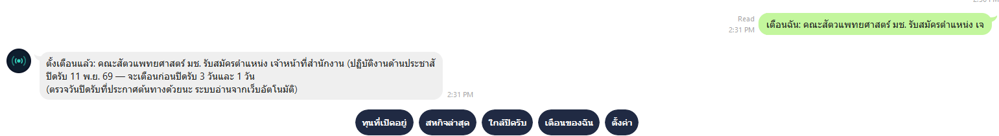 |
| **5. From the website**: the green button opens LINE with `เตือน 42` typed in<br>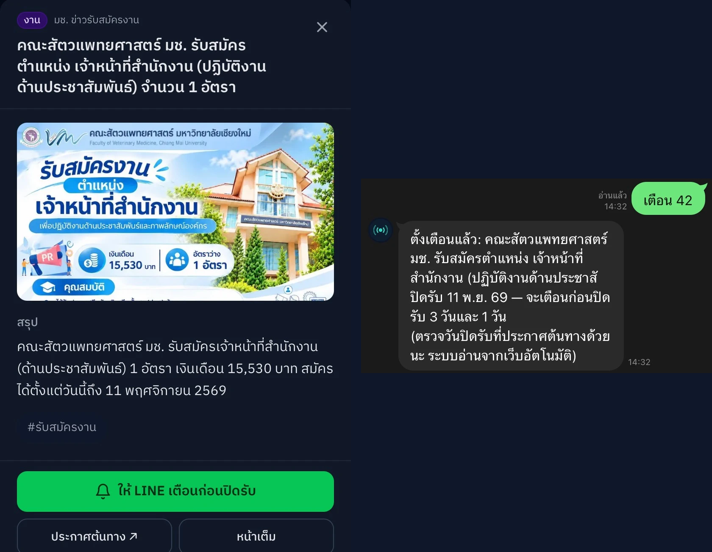 | **6. `เตือนของฉัน`**: my reminders, with ยกเลิกเตือน<br>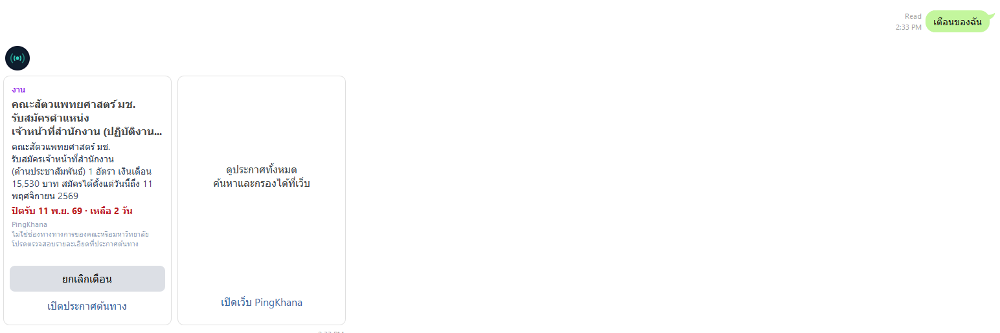 |
| **7. `กิจกรรมล่าสุด`**: latest by category<br>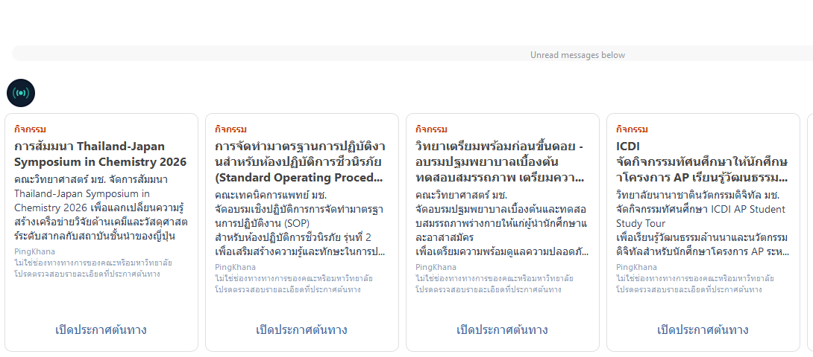 | **8. `ตั้งค่า`** (LIFF): packs (นักศึกษา / ครู), categories, year, major<br>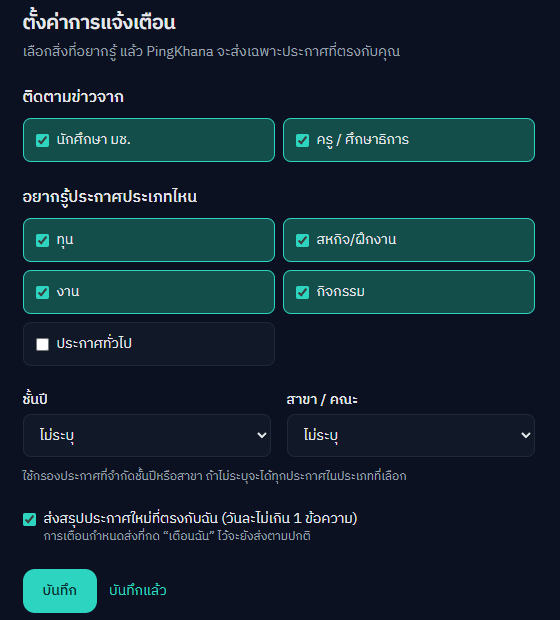 |
| **9. Link the website account**: a code from /account, typed as `ผูก 263649`<br>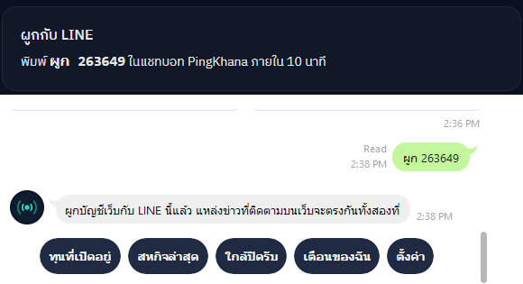 | **10. Anything else → help**, and **`ยกเลิก` deletes everything**<br>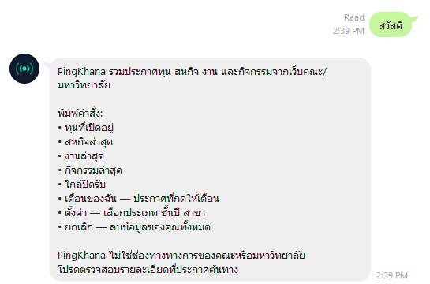<br>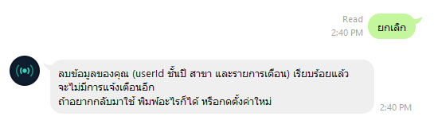 |

Every answer above is a reply message (free). Only reminders and one daily digest use the monthly push quota.

## How it grew

PingKhana started as a bot for one faculty's announcements. Then a teacher asked for the
Ministry of Education's news, so it became a reader for any public news source: groups of
sources ("packs") for students, teachers and everyone, sources people add by pasting a link,
and topic tags across sites. The name stayed: it is where the project came from.

## Why

Announcements are spread over many department, faculty and university pages. Nobody checks all of them every day, so deadlines get missed (the author missed SCB Co-op 2027, which closed on 20 Oct 2026, this way).

## What it does

- **Collector**: reads 5 public CMU pages every hour (see [docs/sources.md](docs/sources.md)). It handles HTML (with RSS support for later sources), obeys robots.txt, identifies itself in the User-Agent, waits between requests and retries on 5xx/429. Duplicates are caught by URL and by a hash of the content, so a post cross-posted on two sites counts once. When a page changes, for example a title gaining "ขยายเวลา" (extended), it is re-read and re-extracted. If a list page stops matching its selectors (a redesign), the source is flagged on `/sources`.
- **Extraction**: a Thai summary, a category (scholarship, co-op/internship, job, activity, general), the **deadline**, eligible years, majors and minimum GPAX. Gemini runs with a JSON response schema when `GEMINI_API_KEY` is set. Otherwise a rule-based extractor is used; it also serves as the fallback and the baseline.
- **LINE bot**: chat commands `ทุนที่เปิดอยู่` (open scholarships), `สหกิจล่าสุด` (latest co-op), `ใกล้ปิดรับ` (closing soon), `เตือนของฉัน` (my reminders), `ตั้งค่า` (settings), `ยกเลิก` (delete my data). Answers come back as flex carousels with a "เตือนฉัน" (remind me) button, the source link and a disclaimer.
- **Reminders**: 3 days and 1 day before the deadline, for announcements the user pressed "เตือนฉัน" on.
- **LIFF settings page**: users pick categories, year and major. Only matching announcements are sent.
- **Public website** (Next.js): a news-style front page of things to apply for (posters from the source sites, the deadlines closing soonest first), a separate **ข่าวสาร** zone for general news, search, filters, detail pages, and source health.
- **Packs and following**: sources belong to a pack (นักศึกษา มช., ครู / ศึกษาธิการ, ทั่วไป). Visitors tick sources and tags on `/follow` without an account (a cookie; the server filters the lists). In LINE the settings page picks packs, and the bot's commands and digests follow them.
- **Add a source by pasting a link** (`/sources/new`): no RSS knowledge needed. The API checks the host is public (no internal addresses) and robots.txt, uses the site's feed if it has one (direct, advertised, or at a usual path), and otherwise asks Gemini for CSS selectors and checks them by parsing the page. People see a preview of the posts; an admin approves on `/admin`.
- **Gemini reads more than text**: the post's poster and its first PDF (also Google Drive links) go into the same call, because dates often live only there. Gemini also adds topic tags, reusing the tags already in use.
- **Reposts merge**: the same announcement on two sites becomes one card that lists the other site.
- **Calendar and sharing**: Google Calendar link and an `.ics` file with alarms 3 days and 1 day before; share to LINE; link previews show the poster.
- **Optional Google sign-in** (off until configured): follows on every device, and a code typed in LINE links the chat to the account.

## Staying inside the free LINE quota

The free LINE Official Account plan in Thailand allows **300 push messages a month**, counted per recipient ([lineforbusiness.com](https://www.lineforbusiness.com/th/service/line-oa-features/broadcast-message), checked 2026-11-04). Reply messages are free. The design follows from that:

- No broadcasts. Each user gets only announcements that match their categories, year and major.
- Everything queued for one user goes into **one push request** (up to 5 message objects), so it costs one message no matter how many items it carries. New announcements are batched into at most one digest per user per day.
- **Reminders come first.** Half the monthly budget, or more if more reminders are already scheduled for the rest of the month, is reserved for deadline reminders. Digests are pushed only above that reserve.
- **Nothing is lost when the budget runs out.** Queued items stay in an outbox and ride along on the user's next reply, which is free, and expire after 14 days.
- Idempotency: each delivery has a unique `dedupe_key`, and pushes carry `X-Line-Retry-Key`, so a job that runs twice or retries never sends twice. Webhook redeliveries are ignored by `webhookEventId`.
- The real usage is read from LINE's `quota` and `quota/consumption` endpoints when available.

## Deadline extraction accuracy

Run with `python -m eval.run_deadline_eval [--set holdout]`. A case is correct when the date matches exactly, or both sides are "no deadline".

| Set | Cases | Rule-based extractor |
|---|---|---|
| Dev set: 26 real sentences + 10 whole saved pages + 12 synthetic ([eval/deadline_cases.yaml](backend/eval/deadline_cases.yaml)) | 48 | 93.8% before tuning → 100% after (the rules were tuned on this set) |
| **Held-out set**: 34 real passages from CMU, KKU and TU pages, collected by a separate agent that never saw the extractor code ([eval/deadline_holdout.yaml](backend/eval/deadline_holdout.yaml)) | 34 | **94.1% on the first (blind) run** (32/34). Both misses were fixed afterwards, so later runs on this set are no longer blind |

Gemini (`--gemini`, first run 2026-11-04, free API key): **97.9%** on the dev set (47/48) and **91.2%** on the held-out set (31/34), so it scored below the rules on held-out data. All three held-out misses gave a date where the expected answer was "no deadline". The run is not a clean test of one model: the main models were overloaded (503) or rate-limited (429), so most cases were answered by the fallback `gemini-flash-lite-latest` (see `answered_by` in [eval/results](backend/eval/results)). In production, the rule extractor takes over whenever Gemini fails.
**Model comparison** (same prompt, temperature 0; `--llm MODEL` goes through FreeLLMAPI, a local OpenAI-compatible router over free LLM tiers, 2026-11-07):

| Extractor | Dev (48) | Held-out (34) | Notes |
|---|---|---|---|
| Rules | 100% (tuned on it) | 94.1% blind first run | no API, instant |
| Gemini (direct API, mostly `gemini-flash-lite-latest`) | 97.9% | 91.2% | 3 held-out misses: gave a date where none was expected |
| Typhoon 2.5 30B A3B instruct (Thai-tuned) | 77.1% | 52.9% | 0 API errors; 25 of 27 misses gave a date where none was expected |

Typhoon reads Thai dates fine but treats event, interview and announcement dates as deadlines, which is exactly the hard part of this task. That backs the production choice: Gemini first, rules as fallback.
Not compared yet: gpt-oss-120b (Groq free tier allows about one 5k-token case per minute, then 429), Qwen 3.8 27B (the free route rejected the long prompts with 413) and Gemini models through the router (daily quota already used). Results with API errors were discarded rather than counted as misses.

About 45% of the cases have **no** deadline (event days, interview dates, posting dates). Telling those apart is the hard part, not parsing `๒๙ ต.ค. ๖๙`.

## Numbers from real use

| | |
|---|---|
| Announcements collected (first run, 2026-11-04) | 68 from 5 sources |
| LINE followers | not launched yet |
| Reminders sent | 0 (not launched yet) |

## Architecture

```
cron-job.org (hourly, ?background=1) ─┐
GitHub Actions (backup schedule) ─────┴─POST /jobs/run─▶ FastAPI (backend/)
   ├─ collector: sources.yaml + approved user sources → fetch (robots, polite) → parse
   │             (HTML selectors or RSS) → posters, PDFs → hash dedupe → store
   ├─ extract: Gemini (text + poster + PDF, JSON schema, tags) within a per-run budget;
   │           rules when out of budget; later runs upgrade rules, read posters, add tags
   ├─ merge reposts across sources (title trigrams + numbers + deadline)
   └─ notify: reminders/digests by each user's packs → push within the LINE budget
LINE ──webhook──▶ /webhook ──reply──▶ user      LIFF (web/liff) ──ID token──▶ /api/liff/*
Website (web/, Vercel) ──▶ /api/announcements, /api/tags, /api/meta, /api/sources (add),
                          /api/admin/* (JOBS_TOKEN), /api/auth/google + /api/me (optional)
Postgres (Neon): announcements, sources (+ user configs), users, accounts, reminders, deliveries
```
- **backend/**: Python 3.12, FastAPI, SQLAlchemy 2 (async) + Alembic, httpx, selectolax. Tests use pytest against real Postgres, respx for HTTP, and fixtures saved from each source.
- **web/**: Next.js 16 (App Router, Cache Components), TypeScript, Tailwind 4, LIFF SDK, Playwright.

## Privacy

- Stored per user: LINE userId, year, major, chosen categories and reminders. Nothing else.
- Typing `ยกเลิก`, pressing "delete my data" in LIFF, or blocking the bot deletes all of it.
- For result lists ("ประกาศรายชื่อผู้ได้รับทุน", lists of scholarship recipients), only the title and link are stored, never the names.

## Run locally

Requirements: Docker, Python 3.12, Node 24 or newer.

```bash
docker compose up -d                       # Postgres on :54532 (+ test DB)
cd backend
python -m venv .venv && .venv/Scripts/pip install -e ".[dev]"   # bin/ on macOS/Linux
cp .env.example .env
.venv/Scripts/alembic upgrade head
.venv/Scripts/python -m app.jobs all       # collect from the real sites (polite, ~5 min first time)
.venv/Scripts/uvicorn app.main:app --port 8100
```

```bash
cd web
cp .env.example .env.local
npm install && npm run dev                 # http://localhost:3000, settings page at /liff
```

Without LINE credentials the bot runs **dry**: messages are logged instead of sent, and `/liff` works with a fake local user.
Tests: `pytest` in `backend/` and `npx playwright test` in `web/` (that one needs the API running with `python -m scripts.seed_demo`).

Connecting to a real LINE channel and deploying: [docs/line-setup.md](docs/line-setup.md).
